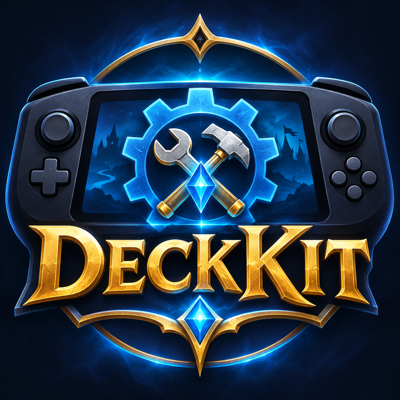

<p align="center"></p>

# DeckKit

Controller-first addons for **WoW: Forever** on the Steam Deck, plus the Deck-side setup that goes with them.

> **Built with AI.** DeckKit is largely developed with an AI coding assistant
> ([Claude Code](https://claude.com/claude-code)). Most of the Lua here was written by Claude
> from my descriptions, then reviewed and tested in-game by me on a Steam Deck. Expect the kind of
> rough edges that come with that, and please report anything broken. Notes for the assistant
> live in [`CLAUDE.md`](CLAUDE.md), and you're welcome to use them if you work on DeckKit with AI too.

> **Active development.** DeckKit grows out of actually playing on the Deck: features get added and
> polished whenever I run into something I need, so expect regular updates. Suggestions are welcome
> in the [issues](https://github.com/fillmoreb/DeckKit/issues).

## Addons (`addons/`)

| Addon | What it does |
|---|---|
| **DeckKit** | The shared core: controller input, windows, shared button overrides (X is shared by wand shoot and fishing), the **DeckKit menu** with every module's settings by topic (double-tap ☰ Menu, or `/deckkit`), **paddle chords** (the back grips alone or together, pressed or held: 30 slots for any action, spells included, see below), Reload UI on F6 |
| **HealPad** | Healing on a controller: the d-pad moves a cursor over party/raid frames and sets your focus; makes focus heal macros from your spellbook (buffs folded into one-button sequences); practice party and raid frames laid out like your real ones (`/deckkit healpad`) |
| **QuestPad** | A big button for the quest item you need: the quest whose real area you're in, or your target's quest (`/deckkit questpad`) |
| **WayPad** | Waypoints dialed in with the d-pad, floating arrow, map + minimap pins, `/way`. With a TomTom-compatible waypoint addon installed, it hands waypoints to that instead (one system at a time) |
| **DisenchantDeck** | List of disenchantable bag items, opened when you pick Disenchant: A disenchants, Y hides, LB/RB shows hidden (`/dd`) |
| **ChatDeck** | Hold a paddle slot to read chat full-screen; right stick scrolls |
| **MapDeck** | Hold a paddle slot for a full-screen map (works in combat); right stick zooms to the continent; shows party/raid, quest markers, waypoints, flight masters, a guard's directions, your spirit healer and zone names |
| **DeckAngler** | Controller fishing: with a pole equipped X casts; per-session catch tally, missed-catch chime, idle reminder (`/deckkit fish`) |
| **DeckHUD** | Interface tweaks: square minimap in the top-right corner (zone name on top, a choice of borders), thin chat frame tucked into the bottom-left; Edit Mode layouts with backups: suggested layout, party frames lined up under your frame and the target's, raid frames in the top-left corner (`/deckkit layout`) |
| **DeckSundries** | Small extras. Wand shoot: Square fires your wand at an enemy instead of swinging (`/deckkit wandshoot`). Friends reply: Y on a friend in the friends list makes them your reply target, so `/r` (or dictating "reply ...") whispers them |
| **MenuReload** | Reload UI button in the game menu, under AddOns |

Everything except MenuReload needs **DeckKit** installed too. Keep SavedVariables and binding names unchanged when refactoring so existing data and binds carry over.

Deploy to the Deck: copy `deploy.local.example` to `deploy.local` and fill in your Deck's SSH target and AddOns path,
then `./deploy.sh WayPad MapDeck` (or no arguments for all). Deploying uses `deckctl` from the
AddonTools dev suite (~/Projects/AddonTools, or set `ADDONTOOLS`), which reloads the game and checks
that every addon loaded without errors.

## Paddle chords: Steam setup

Paddle chords need your WoW: Forever controller layout to make each back grip send two plain keys
(L4 F8/F1, R4 F9/F2, L5 F10/F3, R5 F11/F4: one while held, one after 0.4 s). Everything else
(which grip or chord does what) is set in the game, in the DeckKit menu under **Controls › Paddles**.
Your existing grip bindings become the first slots.

1. In Game Mode, open WoW: Forever's controller settings once, so Steam has a layout for it.
2. Switch to **Desktop Mode** and quit Steam (Steam menu › Exit): Steam rewrites layouts when it exits.
3. In Konsole:
   ```
   curl -LO https://raw.githubusercontent.com/fillmoreb/DeckKit/main/deck-setup/make-chord-layout.py
   python3 make-chord-layout.py --install
   ```
   It finds your Forever layout, keeps a backup next to it (`.bak-before-chords`) and changes only the
   four back grips. With more than one match it lists them; pick one with `--layout <path>`.
   `--hold-ms 300` makes holds quicker (default 400).
4. Back to Game Mode, start the game, and set up slots in **Controls › Paddles**.

**Cheat sheet:** a small list on screen of what your paddles do (each chord's glyph and its action).
Turn it on and pick its spot in **Controls › Cheat sheet**, and untick any slot you don't need
reminding of. It can also go on a chord slot ("Cheat sheet"), or `/deckkit sheet`.

If you use Decktation with push-to-talk on L4+R4, every chord containing L4+R4 starts dictation too.
An "Exact binding only" setting that fixes this is proposed to Decktation; until it's released, avoid
chords that include L4+R4 (or apply `patches/decktation/exact-binding.patch`).

## Suggested WoW settings

These suit playing on the Deck. Each is a toggle on the **Suggested settings** page of the DeckKit menu
(double-tap ☰), with **Apply all suggested** to set them in one go; switching one off restores what you had.

| Setting | Suggested | Why |
|---|---|---|
| Chat style | Classic | Enter sends a message *and* closes the input box, including dictated messages |
| Auto loot | On | Opening a corpse takes everything; no picking items one by one on a controller |
| Controller button legend | Hidden | The always-on list of what each button does, once you know them |

Also worth turning on in **Edit Mode**: *Use Compact Action Bar* on the Gamepad Action Bar (it shows only
the bar you're using). DeckHUD can move the crossbar for you: `/deckkit layout crossbar <px from bottom>`.

## Deck setup (`deck-setup/`)

- `wowforever.bat` – lives at `C:\wowforever.bat` in the Lutris Battle.net prefix; starts Battle.net, waits 8 s,
  then sends `launch WoWF` every 2 s until Wow.exe runs (Battle.net ignores it until it has logged in).
- `addshortcut.py` + `wowforever-art/` – the "WoW Forever" Steam shortcut and its artwork.
- `make-chord-layout.py` – the paddle chord layout (above); `test_make_chord_layout.py` tests it.
- `make-chord-glyphs.py` / `make-minimap-masks.py` – generate DeckKit's chord glyphs and DeckHUD's minimap masks.

## Patches to other people's addons/plugins (`patches/`)

- `decktation/status-hooks.patch` – adds a `statusHookCommand` setting to Decktation 0.3.22: a command run
  on record_start / record_stop / transcription_done / error (`DECKTATION_EVENT`). With
  `deck-setup/decktation-hook.sh` as that command, DeckKit's dictation indicator follows Decktation's real
  state (signal keys INSERT / HOME / END / DELETE). Re-apply after a Decktation update until it's upstream.
- `decktation/exact-binding.patch` – "Exact binding only" (`exactBindingMs`): push-to-talk doesn't start
  when another button joins the binding, so bigger paddle chords stay free. Upstream as a pull request.

## License

MIT, see [`LICENSE`](LICENSE). DeckKit's controller input is adapted from BagPad (MIT, © 2026 Chris), and the shared button overrides and
wand shoot from Improved Forever (MIT, © 2026 markg).
The Steam art in `deck-setup/wowforever-art/` and the logo in `media/` are AI-generated and not covered by the MIT License.
DeckKit is an unofficial fan project, not affiliated with Blizzard Entertainment. World of Warcraft,
Hearthstone and related marks belong to Blizzard.
